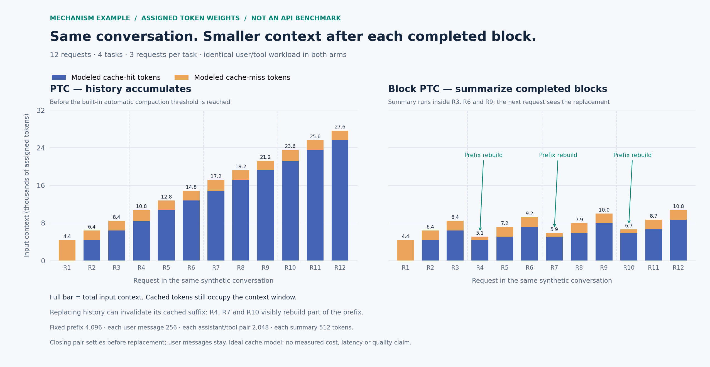

# dsh-block-ptc

**English | [中文](README.zh.md)**

[](https://github.com/mengwEX/dsh-block-ptc/actions/workflows/ci.yml)
[](https://www.npmjs.com/package/dsh-block-ptc)
[](LICENSE)

Blackboard blocks for **PTC mode** in [DeepSeek Harness](https://github.com/deepseek-ai/deepseek-harness).

Version `0.2.0` supports `ids` on both tools. The legacy `id` parameter remains
an alias for `ids: [id]`.

A *block* is a blackboard region. Every program the model runs is tagged with
block ids, and when the block's work is finished the model hands in a summary
**it writes itself** — which then replaces that block's messages in the model's
own context. The original messages stay in the append-only session log, so the
human transcript keeps everything and replay stays deterministic.

- DeepSeek Harness **0.2.0-rc.2 or newer**; no upper version bound
- Community plugin maintained by [mengwEX](https://github.com/mengwEX)
- **Zero runtime dependencies** — the only external import is `node:crypto`
- License: **MIT**

## Table of contents

- [Why](#why)
- [Context and cache comparison](#context-and-cache-comparison)
- [How it works](#how-it-works)
- [Install](#install)
- [Quick start](#quick-start)
- [Reference](#reference)
- [Design notes](#design-notes)
- [Verification](#verification)
- [Troubleshooting](#troubleshooting)
- [Known limits](#known-limits)
- [Development](#development)
- [License](#license)

## Why

Automatic compaction condenses history when token pressure builds, and it
decides what to condense by size. It has no idea that the last forty messages
were one finished sub-task and the next ten are a new one.

This plugin lets the model draw that line itself: open a block, work inside it,
and close it with a handover summary — so the context it keeps is the one it
chose to keep. The model submits the summary inside its program call; the plugin
does not run a separate summarizer model.

## Context and cache comparison



**Mechanism illustration, not an API benchmark.** Both panels replay the same
synthetic four-task workload with assigned token weights. Full bar = input
context; blue = modeled cache hits, orange = modeled cache misses. Cached tokens
still occupy the context window.

After a block closes, the next request carries a summary in place of its
completed work. Replacing history can also invalidate the cached suffix:
**smaller context does not guarantee a higher cache-hit rate or a lower bill**.
The closing assistant/tool pair settles before replacement; original user
messages remain. The baseline has not reached its automatic compaction threshold.

See the [data, assumptions and reproduction steps](docs/context-comparison/README.md).
The plugin's `tokensFreed` is not a provider cache-hit measurement.

## How it works

The model's whole surface is two callables:

```
block_run_code({ ids, description, code })     the only tool it may call directly
await tools.block_summary({ ids, summary })    callable from inside a program
```

1. `block_run_code` delegates its program to built-in PTC `run_code`. Its `ids`
   apply to the complete assistant message, including preceding thinking/text,
   and its tool results. Calls in the same assistant message contribute the
   union of their ids.
2. `tools.block_summary({ ids, summary })` replaces the complete interval from
   the earliest to the latest occurrence of any target id with one summary.
3. The summary inherits the union of the interval's ids minus the target ids.
   It can participate in a later summary. A summary with no remaining ids stays.
4. If a tool pair in the interval is unfinished, the request is queued until
   its result lands. A protected system/user/developer message refuses the
   entire interval; no prefix is silently replaced.

```text
A A B A C B  -- summary([A]) --> S[B] C B
S[B] C B    -- summary([B]) --> T[C]
T[C]        -- summary([C]) --> U[]
A A B A C B -- summary([A, B]) --> S[C]
```

What the human sees afterwards: the transcript still shows every original
turn (the log is append-only); the model's next request shows the summary
instead. In the Web UI the summary renders as a compaction checkpoint node.

## Install

Requirements: DeepSeek Harness `>=0.2.0-rc.2` and its bundled runtime, with
Cordis `>=4.0.4`. Neither peer range has an upper version bound. The plugin
is a profile **bundle**: installing it adds one row to `dsh.profile.bundles`
and one new agent preset, `block-ptc`. It does not modify the shipped `ptc`
preset.

The version ranges allow newer hosts to load the plugin; they are not a record
of completed compatibility checks. Earlier live verification used DSH
`0.2.0-rc.2`; the current browser changes and newer hosts still await live
acceptance. DSH's plugin loader includes prereleases when evaluating its peer
ranges. The plugin checks the required tool/prompt methods before mounting and
the session methods before summarizing, and reports missing capabilities.
Method presence does not verify event semantics, preset configuration or browser
rendering; these still need validation when the host changes.

### From npm (recommended)

Find **dsh-block-ptc** in the Harness Plugin Manager and install it, or ask an
agent with the Plugin Manager tool enabled to install the bundle:

```
plugin_manager  install_bundle  dsh-block-ptc
```

The package is published on [npm](https://www.npmjs.com/package/dsh-block-ptc).
Restart the application after installation and select the **Block PTC** preset.

### From a local checkout

```sh
git clone https://github.com/mengwEX/dsh-block-ptc.git
```

Install the absolute checkout path through the Plugin Manager:

```
plugin_manager  install_bundle  /absolute/path/to/dsh-block-ptc
```

Both methods use pnpm in the target profile. The local form installs a `link:`
dependency for development. Versioned source archives are also available under
[GitHub Releases](https://github.com/mengwEX/dsh-block-ptc/releases).

### Manual install (equivalent, if you prefer files)

In `~/.dsh/profiles/<profile>/package.json`:

```jsonc
{
  "dependencies": { "dsh-block-ptc": "link:/absolute/path/to/dsh-block-ptc" },
  "dsh": { "profile": { "bundles": ["@deepseek-ai/dsh-base", "@deepseek-ai/dsh-web-app", "dsh-block-ptc"] } }
}
```

then run pnpm in that directory.

### After installing

1. The preset appears in the session preset picker as **Block PTC**.
2. **Restart the application once.** The loader keeps a plugin module per
   resolved URL, and installing a bundle changes the composition; a running
   host keeps the old module generation until it restarts.
3. Start a session with the **Block PTC** preset.

### Uninstall

```
plugin_manager  remove_bundle  dsh-block-ptc
```

then restart. `plugin_manager set_bundle dsh-block-ptc enabled=false` disables
it without removing the package.

## Quick start

Say what you want done, then let it close the block when it finishes:

> Read the parser module, explain how the tokenizer works, then close the block
> and continue with the lexer.

You should see:

- the model calling `block_run_code` for everything it runs;
- a closing call to `block_summary` whose return value is
  `{"replaced": 3, "tokensFreed": 346}` — how many messages were replaced and
  the estimated token count of the replaced messages (before counting the new summary);
- a `<block-summary>…</block-summary>` node sitting where those messages were.

If a tool call is refused with *"In block mode only `block_run_code` may be
called directly"*, that is the preset's guard working: in this mode every other
tool is reached from inside a program, exactly like PTC mode.

## Reference

### Tool `block_run_code`

| Parameter | Type | Required | Meaning |
|---|---|---|---|
| `ids` | string[] | yes* | Non-empty, unique block ids for this work, such as `["auth-refactor"]`. |
| `id` | string | no | Legacy alias for `ids: [id]`. Supply either form, not both. |
| `description` | string | yes | One line stating the goal of this work, displayed in the tool row. |
| `code` | string | yes | Program body; top-level `await` and `return` are available and `return` becomes the result. |
| `timeoutMs` | number | no | Elapsed execution budget for this program. |

*`ids` is required unless the legacy `id` is supplied.

Returns the `run_code` result verbatim: `{ logs, result?, sandbox? }`,
rendered exactly as PTC mode renders it. The browser half registers the call
into DSH's keyed Tool view slot and draws the same `code` row the built-in gives
`run_code` — the `Code` title, `[<block ids>] <goal>` as the summary, and the
program plus its output behind the row — with every `bash`/`read`/`write` card
the program dispatches nested inside it.

### Callable `tools.block_summary`

| Parameter | Type | Required | Meaning |
|---|---|---|---|
| `ids` | string[] | yes* | Block ids to summarize and close. |
| `id` | string | no | Legacy alias for `ids: [id]`. Supply either form, not both. |
| `summary` | string | yes | Written by the model. Summarize the complete first-to-last interval for these ids. State the goal, completed work and results, unfinished work, and next step; if only reporting to the user remains, say so. Retain necessary details as appropriate. |

*`ids` is required unless the legacy `id` is supplied.

The replacement text identifies itself as your summary of earlier work and is
wrapped in `<block-summary>…</block-summary>`. It includes a `Block ids` line
only when memberships remain. Empty ids stay in internal metadata. This format
is separate from DSH automatic compaction; both can coexist.

On immediate completion, returns `{ replaced, tokensFreed, ids? }`; `ids`, when
non-empty, are the memberships inherited by the summary. `tokensFreed` is the estimated size of the
replaced messages, before the new summary's cost.

If tool results or another compaction are still pending, returns
`{ replaced: 0, tokensFreed: 0, pending: true, requestSeq, note }`. This acknowledges
queuing, not a completed replacement. The logged successful tool outcome lets
the plugin resume the request after restart/fork. Deferred failures are logged;
target memberships remain until a replacement commits. Missing target ids and
protected messages reject the whole request without removing any memberships.

### Preset `block-ptc`

The shipped `ptc` preset plus:

- `tool-presentation.mode: both` — under `ptc` presentation the reserved
  `run_code` transport is the only directly callable tool, a check that is
  hard-coded in `dsh-tools`, so a plugin tool could never be reached. `both`
  keeps the generated tools SDK and the native schemas;
- this plugin's row, which registers the two callables and a **guard**:
  a model-direct call (no parent token) may only name `block_run_code`, while
  nested calls from inside a program are unrestricted.

## Design notes

**Why delegate instead of reimplementing the transport.** `block_run_code`
hands the program to the built-in `run_code` through
`ctx.tools.execute({ …, parent: exec.token })`. "Identical to PTC mode" is then
true by construction rather than by careful copying.

**Why the nested transport keeps the outer call id.** The PTC bridge parents
every program sub-call at the id of the call that is executing it
(`parentCallId: exec.callId`), and the conversation UI can only attach a
sub-call to a call node it can see in the transcript. Giving the nested
`run_code` a synthetic id such as `<callId>:blk:1` therefore named a parent
that no node renders: the whole sub-call tree was projected away and the block
card showed a bare tool row. Reusing the outer id reproduces PTC mode's topology
exactly — `rootCallId = parentCallId = <callId>`, program sub-calls
`<callId>:ptc:<n>` — so the `bash`/`read`/`write` cards a program dispatches
render inside the block row just as they do in PTC mode.

**Why the package ships a browser half.** DSH maps a wire tool name to its row
inside `@deepseek-ai/dsh-client-ui-tool`, which knows `run_code` and nothing
else; a Host-only tool therefore lands on the generic "Tool call" row. The
registered keyed view (`tool.call.toolview`, key `block_run_code`) is the only
supported way to give the call PTC's row. Its markup, CSS and icons are copies
of the host row renamed under a `dbp-` prefix, because the client-plugin rules
forbid importing Harness client packages as modules; `--dsw-alias-*` theme
tokens are the only shared styling dependency.

**Why the bundle patch also mounts a host-level anchor row.** DSH serves a
package's client module only for packages that appear as host Loader entries
(`dsh-client-modules` scans `ctx.loader.entries()`), and this plugin's
functional row lives inside the `block-ptc` preset, which is a separate tree.
The anchor row (`config.anchor: true`) exists so the package is a host entry; it
registers nothing, because a host-level guard would deny direct tool calls in
every other preset.

**Why the compaction vocabulary.** A message can only disappear from the model's
context through DSH's own surface-replacement mechanism, and a replacement must
carry the events DSH expects around it:

```
compaction/start        takes the durable compaction lock
compaction/summary      states the token price of the exact replaced range
user/message            the replacement itself (surfaceOp: replace, compact-checkpoint source)
compaction/end          releases the lock
```

These are DSH's own session event types (`@deepseek-ai/dsh-compaction`,
`@deepseek-ai/dsh-session`), not names invented here; a plugin cannot define new
event types without making the session log unreadable. **The built-in
compaction engine is never invoked** and no summarization call is made — the
summary is the model's own text, and these four events are only the bookkeeping
DSH requires for the replacement. Every failure makes exactly one close attempt,
so a failed summary can never leave the durable lock behind.

**What is preserved.** System, developer and original user messages are never
replaced. If they occur inside the target interval, the entire operation is
refused. Background-job completion notices from `tool-jobs` inside the interval
are summarized with tool output, including hosts that use the newer plugin
source format. Other plugin messages stay protected. Our own summary checkpoints
may be replaced again. Unfinished tool
pairs delay the complete replacement rather than leaving a target-id suffix.

**Where the state lives.** `tool/call` arguments assign message memberships.
Committed summary checkpoints carry the remaining ids, closed ids and request
sequence in `source.blockPtc`. A summary attempt alone closes nothing. Successful
queued outcomes are replayable; a `session/event` observer schedules completion
outside the append boundary. No second persistence store is used.

**Why the plugin has no external imports.** Profile bundles can be installed as
symlinks; a plugin that imports `@deepseek-ai/dsh-*` by bare specifier can fail
to resolve depending on how the host links it. Its only external import is
`node:crypto`; membership helpers use a bundled relative module.

## Verification

```
npm run check          # syntax + both tests
node tests/logic.test.mjs
node tests/client.test.mjs
```

The `ids` implementation passes these offline tests and append/replay
checks using DSH `0.2.0-rc.2`'s real `Session`. To repeat the optional native check,
run `tests/native-session.mjs` with the installed `dsh-session/lib/index.js` path
as its argument. An ASAR installation requires the desktop executable in
`ELECTRON_RUN_AS_NODE=1` mode. This does not run a model or validate the live UI.

The logic test drives the real plugin entry with a fake context and fake
sessions: tool registration, the guard, the nested `run_code` dispatch, the
whole compaction transaction, the failure path that still releases the lock, and
the discovery anchor that must register nothing. The client test loads
`client/client.js` through a stubbed browser module table and renders the row
for every lifecycle shape — preparation, a dispatched program, a settled result,
a failure, an interruption, and a malformed argument payload — because a keyed
view that throws blanks its slot entry.

Live verification of the row (the browser half is not covered by the unit tests):

1. Install this checkout as a bundle. The desktop profile is managed by the
   desktop app, so use its Plugin Manager with the absolute directory —
   `plugin_manager install_bundle /absolute/path/to/dsh-block-ptc` — or the
   plugin page's "package name or address" field, which accepts an absolute
   local path.
2. Restart the application: the Loader caches resolved modules and the client
   module scan runs at boot.
3. Open a new **Block PTC** session and run any program. The `block_run_code`
   call should render as PTC's own code row, with the program's sub-calls nested
   inside it.

Known cosmetic difference from the built-in row: the running row has no shimmer
sweep, and a DSH row redesign has to be copied here again.

The original development notes record the following live desktop-profile
validation on `0.2.0-rc.2` with the **Block PTC** preset. These are historical
observations, not an end-to-end test run by this repository's CI:

| Step | Observed |
|---|---|
| Direct catalog | `block_run_code` plus the SDK, which also exposes `block_summary` |
| Program run | `block_run_code({ id, description, code })` returns the `run_code` result unchanged |
| Closing | `compaction/start(55) → compaction/summary(56) → user/message(57) → compaction/end(58)`, no error |
| Replacement | `{op: 'replace', startSeq: 19, endSeq: 33}`, sources `[55, 56, 19, 29, 33]` |
| Result | `{"replaced": 3, "tokensFreed": 346}` |
| Surface afterwards | node 0 is still the system prompt, every user message kept, the summary at the replaced position |

The same transaction was replayed offline through the runtime's own
`SurfaceManager` validator against that session's real log and was accepted.

## Troubleshooting

| Symptom | Cause and fix |
|---|---|
| The preset is missing from the picker | The bundle is not in `dsh.profile.bundles`, or the host has not recomposed. Check `plugin_manager list_bundles`, then restart. |
| The preset shows as broken / *"dsh-block-ptc: never started"* | The plugin module failed to import (usually a package-resolution problem for a linked checkout). Fix the layout, then restart. |
| No `block_run_code` in a session | The session is not running the `block-ptc` preset, or the app has not been restarted since installing. |
| Edits to the plugin do not take effect | Modules are cached per URL and module watching is off by default: restart the app. |
| A block never gets compressed | It was never closed with `block_summary`, so its content stays until automatic compaction folds it into a generic summary. |
| Compaction stops working in a session | A `compaction/start` without a matching `compaction/end` is the durable lock. This plugin closes its own bracket on every failure; if you hit it from an older build, start a fresh session. |

## Known limits

- One summary replaces one complete contiguous first-to-last interval. A
  protected system/user/developer message rejects that interval; it is not
  skipped and no prefix is treated as a completed summary.
- Summaries are lossy: necessary information must be included in their text.
- Checkpoints inherit remaining ids and may be summarized again. A checkpoint
  with empty ids is retained as the completed result.
- Existing `id` calls are supported. Already compacted legacy history has no
  recoverable `ids` ownership metadata; it is not retroactively retagged.
- Blocks are per session. Sub-agents run their own context and their own blocks.
- Peer dependencies declare minimum versions without an upper bound. Newer
  hosts are allowed, but compatible event semantics, preset configuration and
  browser APIs still need verification.

## Development

```
.
├── lib/plugin.js        host tools, deferred requests and transactions
├── lib/blocks.js        message memberships and interval planning
├── cordis.patch.yml     the bundle patch: one new preset, `block-ptc`
├── locale/{en,zh}.json  display metadata read by the Harness UI
├── tests/logic.test.mjs the logic and transaction tests
├── RELEASING.md         release and hand-over checklist
└── package.json         bundle manifest (`dsh.bundle.patch`)
```

Run the tests with any Node 22+ (no install step, no dependencies):

```
node tests/logic.test.mjs
```

### Releasing to npm

See [RELEASING.md](RELEASING.md) for GitHub release and npm publication steps.
The package name is `dsh-block-ptc`; the bundle patch resolves that same name.

### Contributing and support

Join the [official community discussion](https://github.com/deepseek-ai/deepseek-harness/discussions/9754)
for feedback on block boundaries and context/cache tradeoffs.

Read [CONTRIBUTING.md](CONTRIBUTING.md), report bugs through
[GitHub Issues](https://github.com/mengwEX/dsh-block-ptc/issues), and follow
[SECURITY.md](SECURITY.md) for private vulnerability reports.

## License

MIT — see [LICENSE](LICENSE). The preset adapts DeepSeek Harness configuration;
see [third-party notices](THIRD_PARTY_NOTICES.md) for upstream attribution.
