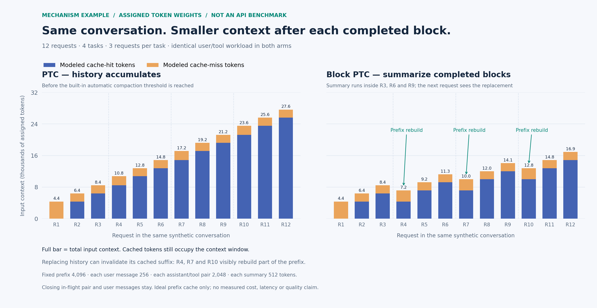

# dsh-block-ptc

**English | [中文](README.zh.md)**

[](https://github.com/mengwEX/dsh-block-ptc/actions/workflows/ci.yml)
[](https://www.npmjs.com/package/dsh-block-ptc)
[](LICENSE)

**Auto Compact with AI-managed context** for [DeepSeek Harness](https://github.com/deepseek-ai/deepseek-harness).

The agent manages its own context as work progresses: it decides **when to
compact, which blocks to organize, and what information to retain**. It can
organize context before a fixed token threshold is reached. Information still
needed for execution, replies or discussion is retained in full; material no
longer needed can be condensed or omitted.

Blocks are the mechanism for organizing related work in PTC mode. The agent
submits the retained content through `block_compact({ ids, content })`, and the
plugin replaces the block interval in its next request. Original messages stay
in the append-only session log. The host's native automatic compaction can
continue to run alongside it.

Version `0.5.0` adapts to DSH `0.2.2-rc.1` and its native PTC executor interface.
Update DSH first, then update this bundle, restart, and start a new **Block PTC**
session. The API remains `block_compact({ ids, content })`.

- DeepSeek Harness **0.2.2-rc.1 or newer**; no upper version bound
- Community plugin maintained by [mengwEX](https://github.com/mengwEX)
- **Native PTC execution** — reuses the executor supplied by DSH
- License: **MIT**

## Table of contents

- [Why](#why)
- [Context and cache comparison](#context-and-cache-comparison)
- [How it works](#how-it-works)
- [Install](#install)
- [Quick start](#quick-start)
- [Reference](#reference)
- [Design notes](#design-notes)
- [Verification](#verification)
- [Troubleshooting](#troubleshooting)
- [Known limits](#known-limits)
- [Development](#development)
- [License](#license)

## Why

A token-threshold trigger tells a system when space is running low. The agent
also knows which work is still active, which results have already been
reported, and which details it will need next.

This Auto Compact mechanism lets the agent use that task knowledge to manage
context proactively. It organizes work into blocks, keeps material needed for
execution and discussion, and compacts earlier material when it is no longer
needed or when reported work gives way to other work. The same agent writes
the retained content; no separate summarizer model is called. Native
threshold-triggered compaction remains available as a separate fallback.

## Context and cache comparison



**Mechanism illustration, not an API benchmark.** Both panels replay the same
synthetic four-task workload with assigned token weights. Full bar = input
context; blue = modeled cache hits, orange = modeled cache misses. Cached tokens
still occupy the context window.

After a block closes, the next request carries a summary in place of its
completed work. Replacing history can also invalidate the cached suffix:
**smaller context does not guarantee a higher cache-hit rate or a lower bill**.
The closing assistant/tool pair settles before replacement; original user
messages remain. The baseline has not reached its automatic compaction threshold.

See the [data, assumptions and reproduction steps](docs/context-comparison/README.md).
The plugin's `tokensFreed` is not a provider cache-hit measurement.

## How it works

The model's whole surface is the built-in PTC transport plus one
program-callable:

```
run_code({ description: "[block: <ids>] <goal>", code })   the only tool it may call directly
await tools.block_compact({ ids, content })                  callable from inside a program
```

1. The header in `run_code.description` names the blocks a program advances.
   Its ids apply to the complete assistant message, including preceding
   thinking/text, and its tool results. Calls in the same assistant message
   contribute the union of their ids.
2. `tools.block_compact({ ids, content })` replaces the complete interval from
   the earliest to the latest occurrence of any target id with the retained content.
3. The summary inherits the union of the interval's ids minus the target ids.
   It can participate in a later summary. A summary with no remaining ids stays.
4. If a tool pair in the interval is unfinished, the request is queued until
   its result lands. A protected system/developer message refuses the
   entire interval; no prefix is silently replaced.

```text
A A B A C B  -- compact([A]) --> S[B] C B
S[B] C B    -- compact([B]) --> T[C]
T[C]        -- compact([C]) --> U[]
A A B A C B -- compact([A, B]) --> S[C]
```

What the human sees afterwards: the transcript still shows every original
turn (the log is append-only); the model's next request shows the summary
instead. In the Web UI the summary renders as a compaction checkpoint node.

## Install

Requirements: DeepSeek Harness `>=0.2.2-rc.1` and its bundled runtime, with
Cordis `>=4.1.0`. Neither peer range has an upper version bound. The plugin
is a profile **bundle**: installing it adds one row to `dsh.profile.bundles`
and one new agent preset, `block-ptc`. It does not modify the shipped `ptc`
preset.

The version ranges allow newer hosts to load the plugin; they are not a record
of completed compatibility checks. Current offline checks use the published
DSH `0.2.2-rc.1` packages. DSH's plugin loader includes prereleases when evaluating its
peer ranges. The plugin checks the required tool/prompt methods before mounting
and the session methods before summarizing, and reports missing capabilities.
Method presence does not verify event semantics, preset configuration or model
behaviour; these still need validation when the host changes.

### From npm (recommended)

Find **dsh-block-ptc** in the Harness Plugin Manager and install it, or ask an
agent with the Plugin Manager tool enabled to install the bundle:

```
plugin_manager  install_bundle  dsh-block-ptc
```

The package is published on [npm](https://www.npmjs.com/package/dsh-block-ptc).
Restart the application after installation and select the **Block PTC** preset.

### From a local checkout

```sh
git clone https://github.com/mengwEX/dsh-block-ptc.git
```

Install the absolute checkout path through the Plugin Manager:

```
plugin_manager  install_bundle  /absolute/path/to/dsh-block-ptc
```

Both methods use pnpm in the target profile. The local form installs a `link:`
dependency for development. Versioned source archives are also available under
[GitHub Releases](https://github.com/mengwEX/dsh-block-ptc/releases).

### Manual install (equivalent, if you prefer files)

In `~/.dsh/profiles/<profile>/package.json`:

```jsonc
{
  "dependencies": { "dsh-block-ptc": "link:/absolute/path/to/dsh-block-ptc" },
  "dsh": { "profile": { "bundles": ["@deepseek-ai/dsh-base", "@deepseek-ai/dsh-web-app", "dsh-block-ptc"] } }
}
```

then run pnpm in that directory.

### After installing

1. The preset appears in the session preset picker as **Block PTC**.
2. **Restart the application once.** The loader keeps a plugin module per
   resolved URL, and installing a bundle changes the composition; a running
   host keeps the old module generation until it restarts.
3. Start a session with the **Block PTC** preset.

### Uninstall

```
plugin_manager  remove_bundle  dsh-block-ptc
```

then restart. `plugin_manager set_bundle dsh-block-ptc enabled=false` disables
it without removing the package.

## Quick start

Work and discuss the results first. Compact earlier blocks when moving to
other work, once their original content is no longer needed:

> Explain how the tokenizer works.
>
> After that discussion: move on to the lexer; organize the earlier block if
> its original content is no longer needed.

You should see:

- the model calling `run_code` with a description such as
  `[block: tokenizer] Explain the tokenizer` for everything it runs;
- a closing call to `block_compact` whose return value is
  `{"replaced": 3, "tokensFreed": 346}` — how many messages were replaced and
  the estimated token count of the replaced messages (before counting the new summary);
- a `<block-summary>…</block-summary>` node sitting where those messages were.

The initial request includes the header requirement in the system prompt,
native tool description and parameter schema. The SDK uses the same header
format.

If a program call is refused with *"Every run_code call, including the first"*, that is the preset's guard working. Retry the
program with the header; the refused call itself is not tagged.

## Reference

Organize blocks around relatively independent units of work, reusing the id
while continuing the same work. Compact a block when its content is no longer
needed, or its results have already been reported to the user and you are
moving on to other work. Keep content needed for upcoming execution, replies
or discussion. Finishing a work step alone is not a reason to compact.

### Header in `run_code.description`

| Part | Type | Required | Meaning |
|---|---|---|---|
| `[block: <ids>]` | header | yes | Comma-separated, non-empty, unique block ids, such as `[block: auth]` or `[block: auth, parser]`. Ids must not contain commas, brackets or line breaks. |
| `<goal>` | string | yes | The goal of this program, on the same line after the header. It is displayed as the tool row's summary. |

`run_code` itself is DSH's tool; the plugin does not replace it. Its
`code`/`timeoutMs` parameters, sandbox, parallel scheduling and result
rendering use the built-in PTC behavior. The plugin aligns the model-facing
header guidance and reads the header to tag surrounding messages.

### Callable `tools.block_compact`

| Parameter | Type | Required | Meaning |
|---|---|---|---|
| `ids` | string[] | yes | Block ids to organize and close. |
| `content` | string | yes | Written by the model. Organize the complete first-to-last interval for these ids. Preserve information still needed for subsequent work in full, with enough detail to continue directly. Briefly summarize information no longer needed; omit irrelevant or duplicate material. Preserve user requirements, corrections and constraints accurately. Record completed work, results, unfinished work and the next step. |

The replacement text identifies information you retained from earlier work and is
wrapped in `<block-summary>…</block-summary>`. It includes a `Block ids` line
only when memberships remain. Empty ids stay in internal metadata. This format
is separate from DSH automatic compaction; both can coexist.

On immediate completion, returns `{ replaced, tokensFreed, ids? }`; `ids`, when
non-empty, are the memberships inherited by the summary. `tokensFreed` is the estimated size of the
replaced messages, before the new summary's cost.

If tool results or another compaction are still pending, returns
`{ replaced: 0, tokensFreed: 0, pending: true, requestSeq, note }`. This acknowledges
queuing, not a completed replacement. The logged successful tool outcome lets
the plugin resume the request after restart/fork. Deferred failures are logged;
target memberships remain until a replacement commits. Missing target ids and
protected messages reject the whole request without removing any memberships.

### Preset `block-ptc`

The shipped `ptc` preset plus:

- `dsh-block-ptc/executor`, which uses the shipped `PtcExecutor` and adapts
  its `describe` output and SDK guidance for block headers. The native executor
  handles execution, sandboxing, nested calls and logging; only `run_code`
  may be called directly;
- this plugin's row, which adds a **guard** that requires the
  `[block: <ids>] <goal>` header on every model-direct `run_code` call (and
  still rejects a direct call to any other tool if the collapse is absent),
  the block rules section, model-facing native transport guidance, and the
  program-callable `block_compact`.

## Design notes

**Why the header instead of a custom transport.** DSH `0.2.1` removed the
`both` presentation mode. Under `ptc`, `dsh-tools` resolves every model-direct
call that is not `run_code` to `UNKNOWN_TOOL` before policy, so a plugin tool
such as the old `block_run_code` can no longer be reached. The supported
transport is `run_code`; the plugin carries block ids in its description and
keeps the transport's exact behaviour by not wrapping or reimplementing it.

**Why the compaction vocabulary.** A message can only disappear from the model's
context through DSH's own surface-replacement mechanism, and a replacement must
carry the events DSH expects around it:

```
compaction/start        takes the durable compaction lock
compaction/summary      states the token price of the exact replaced range
user/message            the replacement itself (surfaceOp: replace, compact-checkpoint source)
compaction/end          releases the lock
```

These are DSH's own session event types (`@deepseek-ai/dsh-compaction`,
`@deepseek-ai/dsh-session`), not names invented here; a plugin cannot define new
event types without making the session log unreadable. **The built-in
compaction engine is never invoked** and no summarization call is made — the
summary is the model's own text, and these four events are only the bookkeeping
DSH requires for the replacement. Every failure makes exactly one close attempt,
so a failed summary can never leave the durable lock behind.

**What is preserved.** System and developer messages are never replaced; an
interval containing them is refused. User follow-ups and tool notices inside
the interval are summarized with the work. The summary must preserve added
requirements, corrections and constraints. Messages outside the interval stay.
A user message arriving after the model wrote the summary is not discarded:
the old summary is refused and must be updated after reading the new message.
Unfinished tool pairs delay the complete replacement.

**Where the state lives.** `run_code` descriptions assign message memberships.
Committed summary checkpoints carry the remaining ids, closed ids and request
sequence in `source.blockPtc`. A summary attempt alone closes nothing. Successful
queued outcomes are replayable; a `session/event` observer schedules completion
outside the append boundary. No second persistence store is used.

**Executor ownership.** DSH `0.2.2` makes tool schemas provider-owned; the
`system-prompt/assemble` waterfall only transforms prompt text and contexts.
The separate executor entry imports the host's `PtcExecutor` peer and adapts
its presentation through the supported executor interface. It forwards the
original execution input and promise to the native executor. The block logic
and interval helpers use relative imports. A linked checkout must have its
host peers resolvable; install a packed bundle to check normal package layout.

## Verification

```
npm run check                  # syntax + the logic test
node tests/logic.test.mjs
```

The logic test drives the real plugin entry with a fake context and fake
sessions: header parsing, tool registration, the guard, the whole compaction
transaction, the failure path that still releases the lock, and the host-API
checks.

The optional native checks use DSH's installed services. For an isolated fixture,
install the host peers and the packed plugin in the same fixture directory:

```
node tests/native-session.mjs /path/to/dsh-session/lib/index.js /path/to/dsh-tools/lib/index.js
node tests/native-prompt.mjs /path/to/dsh-tools/lib/index.js /path/to/installed/dsh-block-ptc/lib/executor.js
node tests/native-preset.mjs /path/to/dsh-tools/lib/index.js
```

The Session check verifies tool schema support, native append/replay and
intervening user-message replacement. The prompt check assembles the initial
request through real SystemPrompt, Tools and Cordis services: the native
`run_code` schema and SDK examples carry the block header, the program SDK
exposes `block_compact({ ids, content })`, and native code/runtime instructions
are preserved. The preset check resolves all module paths, including disabled
rows, and validates the changed preset/executor/subagent configurations. These
checks are offline; they do not run a model or validate
live UI rendering, block selection, compaction timing or information retention.

## Troubleshooting

| Symptom | Cause and fix |
|---|---|
| The preset is missing from the picker | The bundle is not in `dsh.profile.bundles`, or the host has not recomposed. Check `plugin_manager list_bundles`, then restart. |
| The preset shows as broken / *"dsh-block-ptc: never started"* | The plugin module failed to import (usually a package-resolution problem for a linked checkout). Fix the layout, then restart. |
| *"ERR_PACKAGE_PATH_NOT_EXPORTED: .../list-agents"* or *"assembly.tools ... undefined"* | An old bundle is running on the new host. Install the updated bundle, restart, and create a new Block PTC session. |
| No block tagging in a session | The session is not running the `block-ptc` preset, or the model omitted the header (the guard refuses that call). |
| Summary says *"no current content for ids"* | The id never appeared in a `run_code` header in the current surface. Check the header spelling; already summarized ids are closed. |
| New summaries still use the old framing | The host is running an old module generation. Update the bundle and fully quit/reopen DSH. Existing historical summaries keep their original text. |
| Edits to the plugin do not take effect | Modules are cached per URL and module watching is off by default: restart the app. |
| A block never gets compressed | It was never closed with `block_compact`, so its content stays until automatic compaction folds it into a generic summary. |
| Compaction stops working in a session | A `compaction/start` without a matching `compaction/end` is the durable lock. This plugin closes its own bracket on every failure; if you hit it from an older build, start a fresh session. |

## Known limits

- One summary replaces one complete contiguous first-to-last interval. A
  protected system/developer message rejects that interval; it is not
  skipped and no prefix is treated as a completed summary.
- The block header is model-authored. A call without it is refused before
  execution, so untagged work never enters a block.
- Omitted information is unavailable in later model requests. Preserve all
  details still needed for subsequent work in `content`.
- Checkpoints inherit remaining ids and may be summarized again. A checkpoint
  with empty ids is retained as the completed result.
- Blocks are per session. Sub-agents run their own context and their own blocks.
- Peer dependencies declare minimum versions without an upper bound. Newer
  hosts are allowed, but compatible event semantics and preset configuration
  still need verification.

## Development

```
.
├── lib/plugin.js        host-side guard, block_compact, transactions
├── lib/blocks.js        header parsing, message memberships and interval planning
├── lib/prompts.js       block usage and native tool/schema guidance
├── lib/executor.js      supported native PTC executor adapter
├── cordis.patch.yml     the bundle patch: one new preset, `block-ptc`
├── locale/{en,zh}.json  display metadata read by the Harness UI
├── tests/logic.test.mjs the logic and transaction tests
├── RELEASING.md         release and hand-over checklist
└── package.json         bundle manifest (`dsh.bundle.patch`)
```

Run the tests with any Node 22+ (no install step, no dependencies):

```
node tests/logic.test.mjs
```

### Releasing to npm

See [RELEASING.md](RELEASING.md) for GitHub release and npm publication steps.
The package name is `dsh-block-ptc`; the bundle patch resolves that same name.

### Contributing and support

Issues and pull requests are welcome at
<https://github.com/mengwEX/dsh-block-ptc>. Please run `npm run check` before
opening a pull request and describe any live-host verification separately from
offline tests.

## License

MIT. See [LICENSE](LICENSE).
