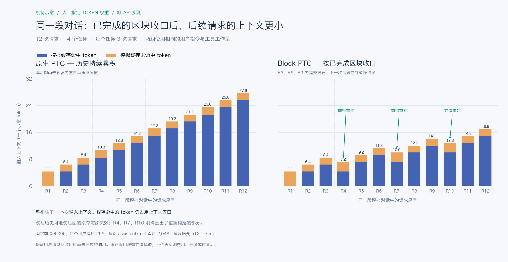

# dsh-block-ptc

**[English](README.md) | 中文**

[](https://github.com/mengwEX/dsh-block-ptc/actions/workflows/ci.yml)
[](https://www.npmjs.com/package/dsh-block-ptc)
[](LICENSE)

给 [DeepSeek Harness](https://github.com/deepseek-ai/deepseek-harness) 的 **PTC 模式**加"黑板块"。

一个 *block* 就是一块黑板区域：AI 跑的每个程序都归属于一个 block id；这块活干完之后，AI 交上一段**自己写的**摘要，这段摘要会替换掉该 block 在**它自己上下文里**的那些消息。原始消息仍然留在只追加（append-only）的会话日志里，所以人的对话记录一条不少，回放也保持确定性。

- 适配 DeepSeek Harness **0.2.0-rc.2**
- 由 [mengwEX](https://github.com/mengwEX) 维护的社区插件
- **零运行时依赖** —— 插件除了 `node:crypto` 不 import 任何东西
- 许可证：**MIT**

## 目录

- [为什么做这个](#为什么做这个)
- [上下文与缓存对比](#上下文与缓存对比)
- [工作原理](#工作原理)
- [安装](#安装)
- [快速上手](#快速上手)
- [接口参考](#接口参考)
- [设计说明](#设计说明)
- [验证](#验证)
- [排障](#排障)
- [已知边界](#已知边界)
- [开发](#开发)
- [许可证](#许可证)

## 为什么做这个

内置的自动压缩是在 token 压力上来时按**体量**决定压哪一段的，它并不知道"刚才那四十条消息是一个已经做完的子任务，接下来十条是新任务"。

这个插件把这条线交给 AI 自己画：开一块，在里面干活，收口时交一段交接摘要——于是留在上下文里的，是**它自己选择要留的**那部分。摘要不额外花一次模型请求，因为收口时它本来就在生成。

## 上下文与缓存对比



**机制示意，不是 API 实测。** 两图使用同一份模拟工作量：4 个任务，每个任务
3 次请求，token 权重人工指定。整根柱子是输入上下文；蓝色是模拟缓存命中，
橙色是模拟未命中。缓存命中的 token 仍占用上下文窗口。

区块收口后，下一次请求用摘要替换已完成的内容。但改写历史也可能使后面的缓存
前缀失效：**上下文变小不保证缓存命中率更高，也不保证费用一定下降**。
收口时尚未完成的 assistant/tool 消息及所有用户消息仍保留。
原生 PTC 在本例中尚未触发内置自动压缩阈值。

[数据、假设与重现方法](docs/context-comparison/README.md) 已一并提供，也说明了
真实实测应采集的 API 字段；`tokensFreed` 不能当作缓存命中统计。

## 工作原理

AI 能直接看到的只有两个可调用：

```
block_run_code({ id, description, code })     唯一可直接调用的工具
await tools.block_summary({ id, summary })    只能在程序内部调用
```

1. `block_run_code` 把程序**原样交给内置的 PTC `run_code` 传输层**执行（嵌套派发），所以程序语义、`tools.*` SDK、子调用日志、沙箱、超时、结果渲染全是内置那套；它额外记下"这一步属于 block `id`"。同一个 id 第一次调用即开块，之后继续沿用。
2. 块开着期间，AI 产生的每条消息都归属它。
3. `tools.block_summary({ id, summary })` 收口：插件取出属于该 block 的会话节点，在**原位置**追加**一条**替换消息，内容就是 AI 写的那段摘要。
4. 一条消息若同时归属多个 block，要等这些 block **全部**收口后才会被替换。

之后你会看到：对话记录里原来的每一轮都还在（日志只追加）；而 AI 的下一次请求里，它们已经变成那段摘要。Web UI 里这条摘要渲染成"压缩检查点"节点。

## 安装

要求：DeepSeek Harness `0.2.0-rc.2` 及其自带运行时。本插件是一个 profile **bundle**：安装它会往 `dsh.profile.bundles` 加一行，并新增一个名为 `block-ptc` 的 agent preset；**不会改动自带的 `ptc` preset**。

### 从 npm 安装（推荐）

在 Harness 的 Plugin Manager 中搜索 **dsh-block-ptc** 并安装，或让启用了
Plugin Manager 工具的 agent 安装 bundle：

```
plugin_manager  install_bundle  dsh-block-ptc
```

包已发布到 [npm](https://www.npmjs.com/package/dsh-block-ptc)。安装后重启应用，
新建会话时选择 **Block PTC** 预设。

### 从本地目录安装

```sh
git clone https://github.com/mengwEX/dsh-block-ptc.git
```

然后通过 Plugin Manager 安装目录的绝对路径：

```
plugin_manager  install_bundle  /absolute/path/to/dsh-block-ptc
```

两种方式都在目标 profile 中使用 pnpm；本地方式安装 `link:` 依赖，适合开发。
也可以从 [GitHub Releases](https://github.com/mengwEX/dsh-block-ptc/releases)
下载指定版本的源码归档。

### 手动安装（等价做法）

编辑 `~/.dsh/profiles/<profile>/package.json`：

```jsonc
{
  "dependencies": { "dsh-block-ptc": "link:/absolute/path/to/dsh-block-ptc" },
  "dsh": { "profile": { "bundles": ["@deepseek-ai/dsh-base", "@deepseek-ai/dsh-web-app", "dsh-block-ptc"] } }
}
```

然后在该目录下跑一次 pnpm。

### 安装之后

1. preset 选择器里会多出 **Block PTC**。
2. **重启一次应用。** loader 按解析后的 URL 缓存插件模块，安装 bundle 会改变合成树，运行中的宿主不会换用新的模块代际。
3. 新建会话时选 **Block PTC**。

### 卸载

```
plugin_manager  remove_bundle  dsh-block-ptc
```

然后重启。只想临时关掉：`plugin_manager set_bundle dsh-block-ptc enabled=false`。

## 快速上手

正常说你要做什么，做完让它收口，比如：

> 读一下 parser 模块，讲清楚 tokenizer 怎么工作，然后把这块收口，再继续看 lexer。

你应该看到：

- AI 跑什么都通过 `block_run_code`；
- 收口时调用 `block_summary`，返回值形如 `{"replaced": 3, "tokensFreed": 346}` —— 替换了几条消息、被替换消息的估算 token 数（尚未扣除新摘要的开销）；
- 一条 `[block:<id>] …` 的摘要节点出现在那几条消息原来的位置。

如果某个工具调用被拒绝、提示 *"In block mode only `block_run_code` may be called directly"*，那是这个 preset 的守门规则在起作用：这个模式里其它工具都要在程序内部调用，和 PTC 模式一致。

## 接口参考

### 工具 `block_run_code`

| 参数 | 类型 | 必填 | 含义 |
|---|---|---|---|
| `id` | string | 是 | block id，短而稳定的 slug，例如 `auth-refactor`。这个程序做的一切都归属它。 |
| `description` | string | 是 | 一句话说明这块的目标。会作为该 block 的持久意图，并成为摘要的标题行。 |
| `code` | string | 是 | 程序主体；支持顶层 `await` 和 `return`，`return` 的值即结果。 |
| `timeoutMs` | number | 否 | 本次程序的执行预算（毫秒）。 |

返回值就是 `run_code` 的结果原样：`{ logs, result?, sandbox? }`，渲染方式与 PTC 模式完全一致。

### 可调用 `tools.block_summary`

| 参数 | 类型 | 必填 | 含义 |
|---|---|---|---|
| `id` | string | 是 | 要收口的 block。 |
| `summary` | string | 是 | 由 AI 撰写的交接内容：目标、做了什么、决策与理由、精确路径、命令、标识符与数值、尚未完成的部分。 |

返回 `{ replaced, tokensFreed }`；若此刻还没有可替换的已提交内容，则返回 `{ replaced: 0, tokensFreed: 0, note }`。
`tokensFreed` 表示被替换消息的估算 token 数，不是净节省量；新摘要本身也占用 token。

### 预设 `block-ptc`

等于自带的 `ptc` 预设，加上：

- `tool-presentation.mode: both` —— 在 `ptc` 呈现模式下，保留的 `run_code` 传输层是唯一可直接调用的工具（这个判断在 `dsh-tools` 里是硬编码的），插件工具永远够不着；`both` 保留生成的 tools SDK 与原生 schema；
- 本插件的行：注册上面两个可调用，并加一条 **guard**：没有 parent token 的"模型直接调用"只允许 `block_run_code`，程序内部的嵌套调用不受限制。

## 设计说明

**为什么是委派而不是重写传输层。** `block_run_code` 通过 `ctx.tools.execute({ …, parent: exec.token })` 把程序交给内置 `run_code`。于是"与 PTC 模式一模一样"是**构造上成立**的，而不是靠小心抄写。

**为什么用 compaction 那套词汇。** 一条消息想让模型看不见，只能走 DSH 自己的 surface 替换机制，而替换必须带上 DSH 要求的前后事件：

```
compaction/start        取得持久压缩锁
compaction/summary      声明被替换范围的 token 计数
user/message            替换本体（surfaceOp: replace，compact-checkpoint 来源）
compaction/end          释放锁
```

这些是 DSH 自己的会话事件类型（`@deepseek-ai/dsh-compaction`、`@deepseek-ai/dsh-session`），不是这里另起的名字；插件也没法自造事件类型——那样会话日志会变得无法读取。**内置压缩引擎从未被调用**，也没有任何摘要模型调用：摘要是 AI 自己写的文本，这四条事件只是 DSH 对这次替换要求的登记手续。任何失败都必定补一次关闭，所以失败的摘要不会把持久锁留在会话里。

**永不替换的东西。** 系统提示和所有 user 角色消息。落在 block 区间内的 user 消息会**切断**区间，而不是被一起压掉；正在执行中的那条 assistant 消息也被排除，因为它的 tool result 还没落盘。

**状态放在哪。** block 是按需从会话日志推导的——开块看 `tool/call`，收口看 `tool/ptc-dispatch-start`——所以会话之外不存任何东西，会话恢复（resume）和 fork 之后 block 依然有效。

**为什么插件没有外部 import。** profile bundle 可以以符号链接方式安装；一个用裸包名 import `@deepseek-ai/dsh-*` 的插件，会因宿主的链接方式解析失败。本插件只 import `node:crypto`，放在哪都能加载。

## 验证

```
node tests/logic.test.mjs
```

测试用假的 Cordis 上下文和假会话驱动**真实的插件入口**：工具注册、guard、嵌套 `run_code` 派发、完整的压缩事务，以及"失败也要释放锁"的路径。

原始开发记录包含以下真实 desktop profile（`0.2.0-rc.2`）上的 **Block PTC**
验证结果。这些是历史实测记录，仓库 CI 不会启动宿主重新执行端到端验证：

| 环节 | 实测结果 |
|---|---|
| 直接工具目录 | `block_run_code` + SDK（SDK 里另有 `block_summary`） |
| 程序执行 | `block_run_code({ id, description, code })` 原样返回 `run_code` 的结果 |
| 收口 | `compaction/start(55) → compaction/summary(56) → user/message(57) → compaction/end(58)`，无 error |
| 替换 | `{op: 'replace', startSeq: 19, endSeq: 33}`，sources `[55, 56, 19, 29, 33]` |
| 返回 | `{"replaced": 3, "tokensFreed": 346}` |
| 之后的 surface | node 0 仍是系统提示，所有 user 消息保留，摘要正好落在被替换的位置 |

同一次事务还被离线喂给运行版自己的 `SurfaceManager` 校验器（用那个会话的真实日志），一次通过。

## 排障

| 现象 | 原因与处理 |
|---|---|
| preset 列表里没有它 | bundle 不在 `dsh.profile.bundles` 里，或宿主还没重新合成。查 `plugin_manager list_bundles`，然后重启。 |
| 预设显示为 broken / *"dsh-block-ptc: never started"* | 插件模块 import 失败（本地链接安装时通常是包解析问题）。修好布局后重启。 |
| 会话里没有 `block_run_code` | 该会话没跑 `block-ptc` 预设，或安装后还没重启应用。 |
| 改了插件代码不生效 | 模块按 URL 缓存，且模块监听默认关闭：重启应用。 |
| 某块一直没被压缩 | 它从没用 `block_summary` 收口，内容会一直占着，直到内置自动压缩把它压成通用摘要。 |
| 某会话的压缩不工作了 | 出现没有配对的 `compaction/start` 就是持久锁。本插件在任何失败路径上都会补关闭；若是旧版本留下的，开新会话。 |

## 已知边界

- 一个 block 的范围是"开块的那次 `block_run_code`"到"收口的 `block_summary`"之间的全部内容。若期间另一个 block 一直开着，只会替换第一段连续可释放的内容，其余留给后来覆盖它的那次收口。
- 摘要按设计是有损的：AI 没写进去的东西，之后就从它的上下文里消失了。
- 一个 block 一次替换、一段摘要一条消息，没有"摘要的摘要"这种二级提纲。
- block 是会话级的；子代理有自己的上下文和自己的 block。
- 插件按 `peerDependencies` 锁定确切的 DSH 版本；换运行时记得同步升级。

## 开发

```
.
├── lib/plugin.js        插件全部代码（零外部 import）
├── cordis.patch.yml     bundle 补丁：新增一个 preset `block-ptc`
├── locale/{en,zh}.json  Harness UI 读取的显示文案
├── tests/logic.test.mjs 逻辑与事务测试
├── RELEASING.md         发布与交接清单
└── package.json         bundle 清单（`dsh.bundle.patch`）
```

任意 Node 22+ 即可跑测试（无需安装、无依赖）：

```
node tests/logic.test.mjs
```

### 发布到 npm

GitHub 版本发布与 npm 发布流程见 [RELEASING.md](RELEASING.md)。包名统一使用
`dsh-block-ptc`，bundle 补丁也通过同名包解析插件。

### 贡献与反馈

欢迎在[官方社区介绍帖](https://github.com/deepseek-ai/deepseek-harness/discussions/9754)
交流区块收口与上下文、缓存之间的取舍。

贡献方式见 [CONTRIBUTING.md](CONTRIBUTING.md)，问题反馈请使用
[GitHub Issues](https://github.com/mengwEX/dsh-block-ptc/issues)；安全漏洞请按
[SECURITY.md](SECURITY.md) 私下报告。欢迎使用中文或英文。

## 许可证

MIT —— 见 [LICENSE](LICENSE)。预设改编自 DeepSeek Harness 的配置，
上游版权声明见 [THIRD_PARTY_NOTICES.md](THIRD_PARTY_NOTICES.md)。
